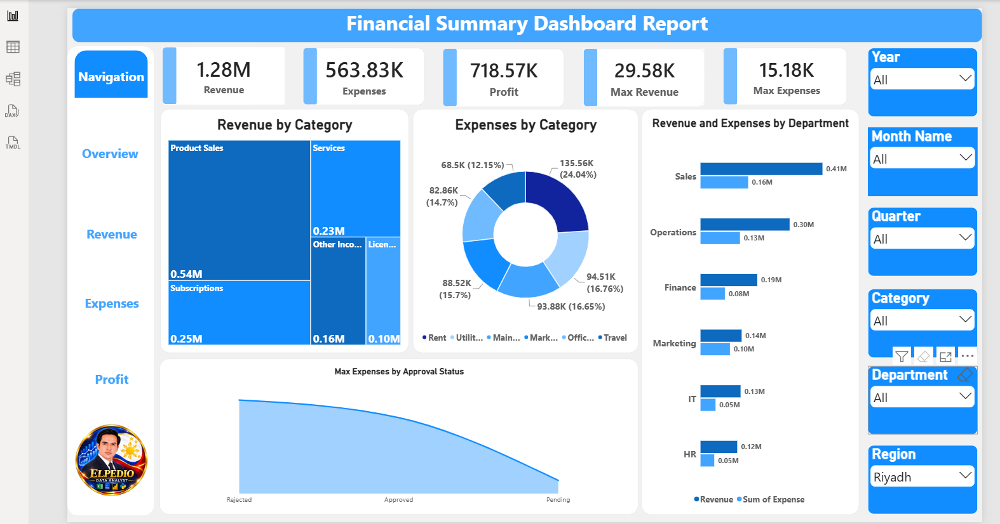
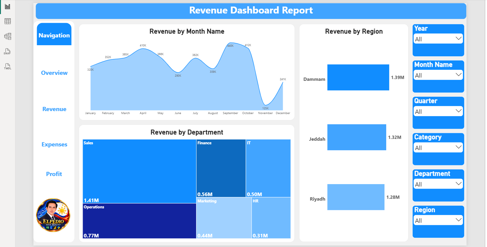
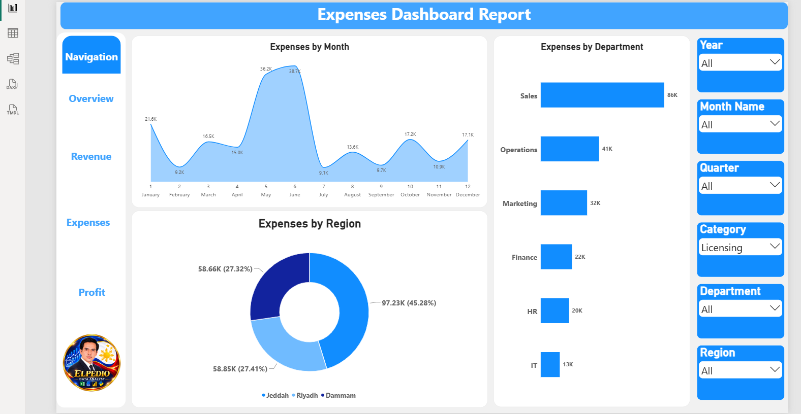
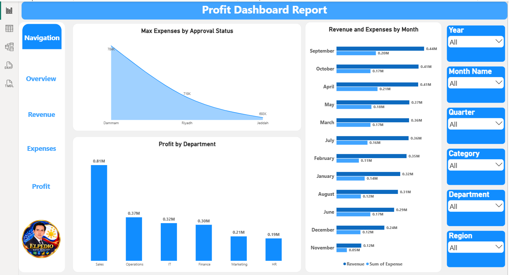
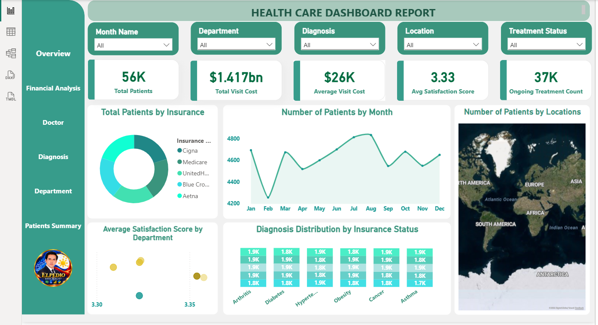
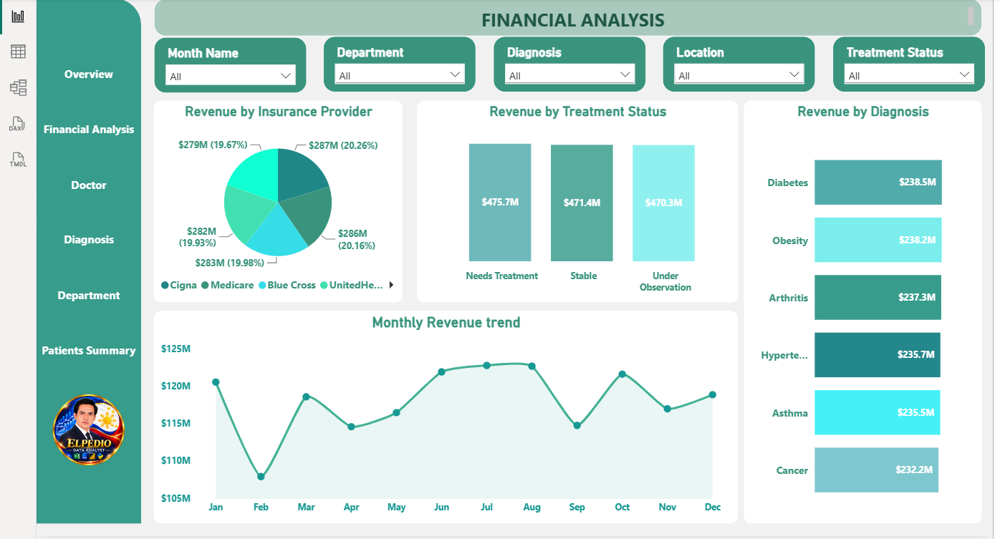
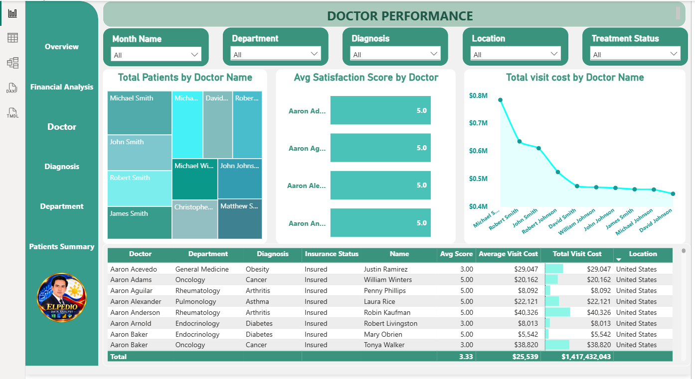
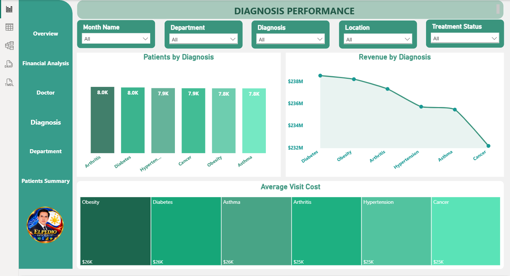
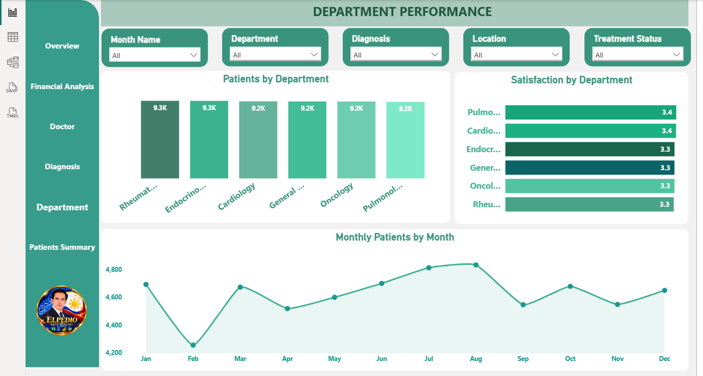
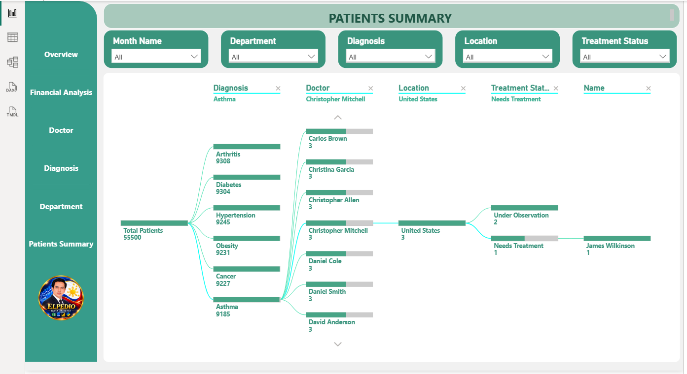

# Elpedio28.github.io
Professional Data Analytics Portfolio showcasing HR, Financial, and Healthcare Analytics projects using Power BI, Excel, SQL, and Python.
## Financial Analytics Dashboard

### Project Overview

An interactive financial dashboard developed using Microsoft Power BI to analyze business financial performance.

### Key Features

* Revenue Analysis by Month, Region, and Department
* Expense Analysis by Category and Department
* Profitability Analysis
* KPI Cards for Revenue, Expenses, and Profit
* Interactive Filters for Year, Month, Quarter, Category, Department, and Region

### Tools Used

Power BI, DAX, Power Query

### Project Files

* [Download Power BI Dashboard](Financial%20Dashboard.pbix)
* [View PDF Documentation](Financial_Dashboard_Report.pdf)
### Dashboard Screenshots

**Financial Overview**

**Revenue Analysis**

**Expense Analysis**

**Profit Analysis**

---

## Healthcare Analytics Dashboard

### Project Overview

An interactive Healthcare Analytics Dashboard developed using Microsoft Power BI to analyze healthcare performance and operational indicators.

### Key Features

* Healthcare KPI Analysis
* Patient and Operational Analysis
* Healthcare Performance Monitoring
* Interactive Dashboard Visualizations

### Tools Used

Power BI, DAX, Power Query

### Project Files

* [Download Power BI Dashboard](Health%20Care.pbix)
* [View PDF Documentation](Healthcare_Analytics_Dashboard.pdf) 

### Healthcare Dashboard Screenshots

**1. Healthcare Overview**

**2. Financial Analysis**

**3. Doctor Performance**

**4. Diagnosis Analysis**

**5. Department Analysis**

**6. Patient Summary**

---

# HR Analytics Dashboard

## Project Overview

An interactive HR Analytics Dashboard developed using Power BI to analyze employee information, recruitment, workforce performance, employee leaves, transactions, and payroll.

## Key Features

- Employee Headcount Analysis
- Recruitment and Hiring Analysis
- Employee Leave Monitoring
- Employee Transaction Analysis
- Payroll and Salary Breakdown
- Department and Workforce Analysis

## Tools Used

Power BI, DAX, Power Query, Excel

## Project Files

- [Download HR Dashboard](HR%20Dash%20Board.pbix)
- [View HR Report PDF](HR_Analytics_Report_pdf.pdf)

## HR Dashboard Screenshots

### 1. HR Overview

### 2. Employee Leaves

### 3. Employee Transactions

### 4. Recruitment Analysis

### 5. Payroll Analysis

